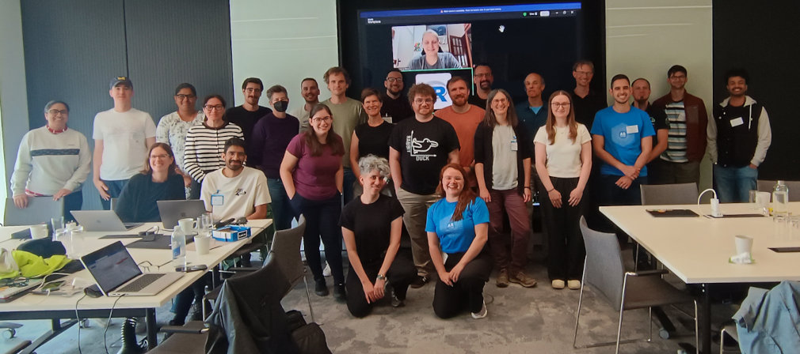
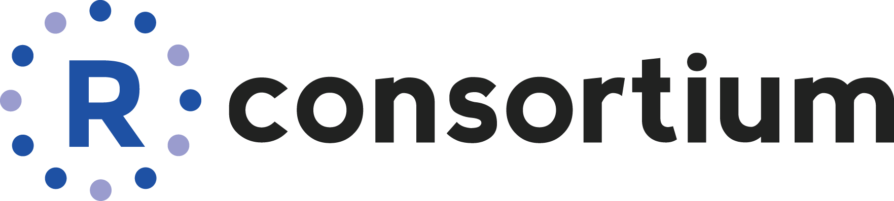

**Week beginning April 12, Boston, USA**

```{r setup, include=FALSE}
knitr::opts_chunk$set(echo = FALSE)
source(file.path("R", "functions.R"))
```

*Collaborate on contributions to base R!*

We are pleased to announce another R Project Sprint, to be hosted in **Boston, USA, in the week of Monday April 12, 2027**.
Novice and experienced contributors are encouraged to apply for a place, with funding available for travel and accommodation (deadline **Friday 4 December**).
Read on for more! **#RSprint2027**

{fig-alt="A group photo of participants at R Project Sprint 2026" fig-align="center"}

## About the sprint

R is a popular and widely used software for data science. Like any large open source software project, it takes a lot of work to maintain and develop. Much of the work is done by a small number of volunteers and there is a need to grow the contributor community.

This sprint will bring together novice and experienced contributors, to work alongside members of the R Core Team. Participants will work collaboratively on contributions to base R and related infrastructure. The tasks will be prepared in the run-up to the event, but may include:

- Reviewing, analysing and fixing bugs reported on R's [Bugzilla](https://bugs.r-project.org/).

- Work on new developments proposed by core developers.

- Contributing to CRAN packages affected by changes in base R.

- Maintaining translation infrastructure such as the [Weblate](https://translate.rx.studio/projects/r-project/) instance.

- Developing contributor infrastructure such as the [R Development Guide](https://contributor.r-project.org/rdevguide/).

<!-- 
For a short report on R Project Sprint, see the [BEAR Blog post]() [link TBA].

You can read about the previous edition in 2023 in [this R Journal article](https://journal.r-project.org/news/RJ-2023-3-sprint/).
-->

## Who can take part?

The sprint will involve a mixture of invited and self-nominated participants, so that we have contributors at all experience levels.

The main criteria for participation is a good knowledge of R programming and a keen interest in contributing, as we hope participants continue to contribute after the event. The table below shows the type of knowledge/skills we expect participants to have:

| Skills most will have | Skills some will have |
|:-----------------------:|:----------------------------------:|
| Writing R functions | Programming in C |
| Debugging R functions | Knowledge of S3/S4 classes and methods |
| Writing R help files | Expertise in statistical methods in **stats**, **splines** |
| Using git/Subversion | Able to build R from source |

Other specialist skills would of course be welcome, e.g. expertise in Windows/macOS development, graphics and font rendering, accessibility, or compilers and build systems.

It will help if you have some experience in contributing to base R, but novice contributors will be mentored in the run-up to the event, so they are prepared.

We are also keen to foster a diverse community of contributors. If you are a member of the [R-Ladies+](https://rladies.org/), [rainbowR](https://rainbowr.org/), or [LatinR](https://latin-r.com/) communities, or otherwise identify as part of an underrepresented group among R contributors, then we especially encourage you to self-nominate! To ensure a welcoming environment, we have a code of conduct in place.

## Apply for a place

Anyone interested to attend the sprint is encouraged to self-nominate via the [application form](https://rfoundation.limequery.com/375163) by **Friday 4 December**. 
You will be asked about your experience, skills and background to help us balance participation overall.

Thanks to our [sponsors](#sponsors), lunch and refreshments will be provided for all participants during the sprint.

Funding is also available to cover participant travel and accommodation. 
However if participants are able to fund their travel and accommodation from other sources this will allow more people to attend - companies or other funding bodies providing such support to participants can be acknowledged as sponsors.

## Practicalities

<!--
The sprint will take place at the Precision Health Technologies Accelerator (PHTA), next to the Edgbaston campus of the University of Birmingham. See the [Travel](travel.html#travel-to-sprint-venue-phta) page for getting to the venue from on-campus accommodation/hotels and the [Schedule](schedule.html) page for the schedule and room information.\
\
The Edgbaston campus is 3 miles South-West of Birmingham city centre. It is reachable by train from nearby European countries, or by plane to Birmingham International (BHX) or other UK airports. 
-->

See the [US Visa Wizard](https://travel.state.gov/content/travel/en/us-visas/visa-information-resources/wizard.html) for determining which visa, if any, you may need to travel to the sprint.

As travel funding is available, in-person participation is the default. However a small number of remote participants may be accommodated. There is space to make a case for remote participation on the application form.

## What's on nearby

Participants may be interested to know of these events happening close to the sprint:

- Saturday 10 April, [PgDay Boston 2027](https://2027.pgdayboston.org/), PostgreSQL and open-source conference at Tufts University.

- Monday 19 April	[Boston Marathon](https://www.baa.org/races/boston-marathon/), with related events over the weekend 17-18 April.


## Organizing team

<!-- put headshots where we will for general participants -->

::::: people-gallery
::: {#person1}
```{r, results = "asis"}
person_info(name = "Heather Turner",
            affiliation = "Principal RSE<br>R Core Developer",
            pic = "participants/optimized/heather_turner.jpg",
            alt = "Headshot of Heather Turner smiling for the camera. She is a middle-aged white woman with dark, shoulder-length straight hair and wears glasses.",
            website = "https://www.heatherturner.net/",
            email = "h.l.turner@bham.ac.uk")
```
:::

::: {#person2}
```{r, results = "asis"}
person_info(name = "Mikael Jagan",
            affiliation = "Software Engineer<br>R Core Developer",
            alt = "Headshot of Mikael Jagan",
            website = "https://codeberg.org/jaganmn")
```
:::

:::::

We are coordinating with the wider [R Contribution Working Group](https://contributor.r-project.org/working-group) and the R Core Team.

## Contact

For queries about this event, please contact [h.l.turner\@bham.ac.uk](mailto:h.l.turner@bham.ac.uk).

## Sponsors {#sponsors}

### Core funding

Providing sponsorship for general participant travel and accommodation, plus venue and catering costs\

[{fig-alt="R Consortium logo" fig-align="left" width="300"}](https://www.r-consortium.org)

### Platinum sponsors

Providing sponsorship for R Core travel.

::: flex-container
[The R Foundation](https://www.r-project.org/foundation/)
:::

Further sponsors welcome to support participant travel, accommodation and/or social events. Sponsors will be acknowledged on this website, on the R Contributors [Mastodon](https://hachyderm.io/@R_Contributors) account, and in reports of the sprint. Please contact [h.l.turner\@bham.ac.uk](mailto:h.l.turner@bham.ac.uk) to discuss!
